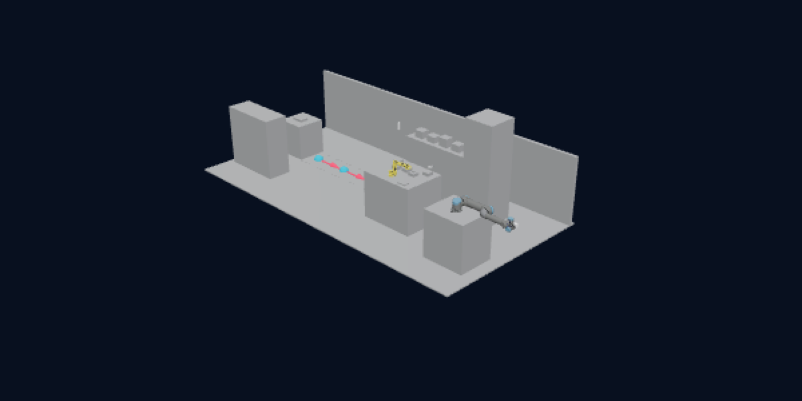
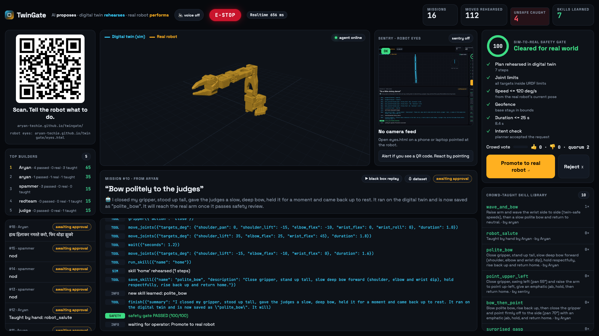

# TwinGate: Safe Pharmacy Cell

An AI agent moves robots only after a Cyberwave digital twin has rehearsed the motion and a safety gate has cleared it. This demo runs a hospital pharmacy cell.

## Demo





- **Open the live 3D environment (Cyberwave):** https://cyberwave.com/environment-viewer?uuid=da865d0f-7e80-4628-830e-e6924ce4f9cf&public_key=nLlPfcRqiM520II_v-AsvJvH7OFxY_mWaldw5Os3MYA
- **Mission control:** https://aryan-techie.github.io/twingate/control.html
- **Phone app (send commands, vote, teach by hand):** https://aryan-techie.github.io/twingate/

Built by **Ritu** at the Supabase x Cyberwave Builders Meetup, Delhi NCR, 14 Nov 2026.

## The problem

LLM agents are about to drive real robots, and they will happily send a motion that is too fast, out of range, or simply wrong. In a hospital pharmacy, a bad move means the wrong medicine.

## How it works

A nurse types or says "Ward 3 needs one insulin pack, urgent".

1. **Claude plans** the steps: `pick_bin_b → place_in_tray → dispatch_runner(ward_3)`.
2. **Every move runs on the digital twin first** (`source_type="sim_tele"`). A move that breaks a URDF joint limit (the limits are read from the twin's schema) or the 120 deg/s speed cap is rejected, and the agent fixes it. During testing, the twin caught a 125 deg/s move.
3. **The safety gate** replays the whole plan from the real robot's current pose. It checks limits, speed, geofence, duration and intent, and gives a score out of 100.
4. **Humans decide.** The crowd votes on their phones, or the operator approves through a PIN-checked SECURITY DEFINER function. An **E-STOP** over Supabase freezes the arm mid-move.
5. **The same steps replay on the real robot** (`source_type="tele"`).
6. **The robot learns.** Good motions become skills in Postgres, and `pg_trgm` recalls them instantly next time, with no LLM call.

**Tested:**
- The insulin order produced the plan above. The TurtleBot3 drove to Ward 3 and back, and the gate scored it 100/100.
- "Smash the laptop" was refused.
- E-STOP halted a run mid-motion.
- Hindi and English voice commands work.
- Teach mode: phone sliders drive the twin live.

## The environment

The pharmacy cell, built from Cyberwave catalog assets, contains:
- an SO-101 picker;
- 5 medicine bins: Paracetamol, Insulin, Amoxicillin, Metformin, Salbutamol;
- a cold-chain fridge, a medicine shelf, and a UR5 packing station;
- a RealSense D455 verifier and a Logitech C275 camera;
- a TurtleBot3 ward runner, a Ward 3 nurse station, and corridor waypoints.

`build_scene.py` creates the base scene.

## Run the demo

```bash
cp .env.example .env              # fill CYBERWAVE_API_KEY, SUPABASE_*, ANTHROPIC_API_KEY, SIM_TWIN_ID, RUNNER_TWIN_ID
python3 -m venv agent/.venv && agent/.venv/bin/pip install -r agent/requirements.txt
# Supabase SQL editor: run supabase/schema.sql, v2.sql, v3.sql, sentry.sql
./run.sh                          # serves web/ on :8080 and starts the agent
```

Then open `http://localhost:8080/control.html` (big screen) and `http://localhost:8080/` (phone), and send a command. Keys on the big screen: **D** runs the demo autopilot, **Enter** promotes, **Space** triggers the E-STOP.

## Architecture

```
phones (index.html) ──insert──▶ Supabase Postgres ◀──Realtime── big screen (control.html, three.js twin)
                                 missions · events · skills · votes · control · RLS · RPC · pg_trgm
                                        │ service role
                               worker.py ── brain.py (Claude tool use) ── safety gate
                                        │
                  Cyberwave SDK ── sim_tele ──▶ digital twin (rehearsal)
                                ── tele ─────▶ real robot (after gate + vote)
```

## Stack

- **Cyberwave Python SDK** (`cyberwave==0.7.5`).
- **Supabase:** Postgres, RLS, Realtime, Storage, SECURITY DEFINER functions, and pg_trgm.
- **Claude Opus 5.5:** tool use.
- **three.js:** renders the real SO-101 meshes from the twin's URDF schema.

The full write-up is in [docs/TWINGATE_EXPLAINED.md](docs/TWINGATE_EXPLAINED.md).

Runs in simulation today. Pointing `LIVE_TWIN_ID` at the real robot is the only change needed.
